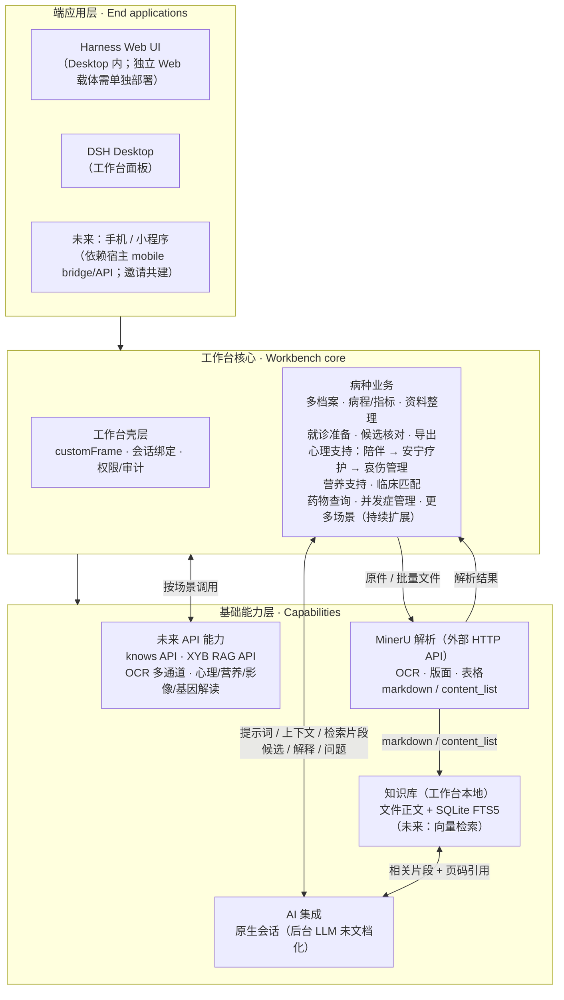
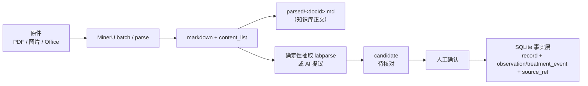

# 架构说明 · OpenHarness DSH Plugins

> 状态：组织级架构说明（v0.1，2026-10-29）。
> 范围：本组织的工作台、插件、基础能力与端应用如何组合；不展开 DSH Desktop 自身的 Electron/Harness 内部实现（见 [dsh-desktop architecture](https://github.com/dataelement/dsh-desktop/blob/main/docs/architecture.md)）。
> 参考实现：`breast-cancer-workbench` v0.13.5；其它工作台可能只实现了其中一部分。

---

## 1. 一句话

**以工作台为核心：向下接 AI、MinerU、知识库和未来 API，向上承载 Web / 工作台 App / 未来手机与小程序；AI 与工作台双向，MinerU 只负责解析，事实写入始终经过候选与人工确认。**

---

## 2. 三层架构



### 2.1 ASCII 版（不看 Mermaid 也能读）

```text
┌────────────────────────────────────────────────────────────────────┐
│ 端应用层                                                           │
│   Harness Web UI（Desktop 内；独立 Web 需单独部署）                │
│   DSH Desktop（工作台面板） · 未来：手机/小程序（依赖宿主 API）     │
└───────────────────────────────┬────────────────────────────────────┘
                                │
┌───────────────────────────────▼────────────────────────────────────┐
│ 工作台核心                                                         │
│   壳层：customFrame / 原生会话绑定 / 权限与审计                     │
│   业务：多档案 · 病程与指标 · 资料整理 · 就诊准备 · 候选核对 · 导出 │
│         心理支持（陪伴 → 安宁疗护 → 哀伤管理）· 营养支持 · 临床匹配 │
│         药物查询 · 并发症管理 · 更多场景（持续扩展）                │
└───────┬───────────────────┬───────────────────┬────────────────────┘
        │ 双向              │ 原件/批量         │ 检索/索引
┌───────▼────────┐  ┌───────▼────────┐  ┌───────▼────────┐
│ AI 集成        │  │ MinerU（外部） │  │ 知识库（本地） │
│ 原生会话       │  │ OCR/版面/表格  │  │ 文件 + FTS5    │
│ 后台任务待定   │  │ markdown/JSON  │  │ 未来向量检索   │
└───────┬────────┘  └───────┬────────┘  └───────┬────────┘
        │                   │                   │
┌───────▼───────────────────▼───────────────────▼────────────────────┐
│ 未来 API：knows API · XYB RAG API · OCR 多通道 · 心理/营养/影像/基因 │
└────────────────────────────────────────────────────────────────────┘
```

> 这是**逻辑分层**，不是进程/部署图。工作台不是独立进程；它是装在 profile 里的 DSH 插件：服务端跑在 Harness 进程，客户端 Panel 跑在 Harness Web UI。运行时映射见 2.2。

### 2.2 运行时映射：工作台作为 DSH 插件

```text
Electron Main
  ├─ Harness 进程（Node，127.0.0.1 随机端口）
  │    ├─ Cordis 插件加载器 / profile
  │    │    └─ 工作台插件 = dsh/ 服务端 + lib/client.js 客户端
  │    │         ├─ 服务端：注册 desktopWorkbenches、/api/<wb>/*、读写 workspace
  │    │         └─ 客户端：Panel（header + iframe(public/) + 原生 conversation + splitter）
  │    └─ 外部调用：MinerU / knows / XYB RAG（HTTP，需同意）
  ├─ 沙箱 BrowserWindow → Harness Web UI
  │    ├─ 原生会话（conversation）
  │    └─ 工作台 Panel → iframe(public/ UI)
  └─ userData/harness/profiles/web
       ├─ package.json / dsh.profile.bundles / .secrets
       └─ 工作台 tgz 安装在这里
```

工作台 **SQLite 不在 profile 里**，而在用户选择的资料目录（workspace）：

```text
用户选择的资料目录/（workspace，独立于 DSH profile）
  ├─ pinkypal.sqlite（各仓 DB 名可能不同，如 xyb.db）
  ├─ documents/（原件）
  ├─ parsed/（解析文本）
  └─ active.json / settings.json
```

对应关系：

| DSH 运行时 | 工作台插件落在哪 |
| --- | --- |
| Electron Main | 不管业务；负责窗口、IPC、Harness 生命周期 |
| Harness 进程 | `dsh/index.js`、`dsh/server.js`、`dsh/host.js`：注册、HTTP、数据层 |
| Harness Web UI | `lib/client.js`：`__ModuleLoader__.load` 注册 Panel |
| 沙箱窗口 | `public/` 业务页跑在 Panel 的 iframe 里 |
| 原生会话 | 宿主把 `conversation` 节点作为 prop 交给 Panel；AI 不在插件进程里 |
| profile | 工作台 tgz 装在 `profiles/web`，`dsh.profile.bundles` 列出 |
| 用户资料目录 | 工作台自己的 workspace：SQLite / documents / parsed；与 profile 分开 |

两条数据面不要混：

- `userData/harness/profiles/web`：插件、会话、设置、`.secrets`。
- 用户选择的资料目录：业务 SQLite、原件、解析文本；卸载插件默认不动它。

> 常见误解：CLI/`dsh web` 的 `~/.dsh/profiles/web` 与 Desktop 的 `~/Library/Application Support/dsh-desktop/harness/profiles/web` 不是同一个位置；装错位置会“安装成功但左侧无入口”。

### 2.3 数据面：SQLite 在哪、谁能访问

| 数据 | 位置 | 谁访问 |
| --- | --- | --- |
| 工作台业务 SQLite | `<用户选择的资料目录>/*.sqlite`（如 `pinkypal.sqlite`、`xyb.db`） | 工作台服务端（Harness 进程内） |
| 原件 | `<workspace>/documents/` | 工作台服务端 |
| 解析文本 | `<workspace>/parsed/` | 工作台服务端 / 知识库索引 |
| profile | `userData/harness/profiles/web` | DSH/Harness；工作台只关心包与身份 |
| 会话库 | Harness `sessions/` | 宿主；工作台不直接读写 |
| `.secrets` | 工作台包内或用户级 | 工作台服务端 |

访问链路：

```text
Web UI / Panel ──HTTP──▶ /api/<wb>/* ──▶ 工作台服务端 ──▶ workspace/*.sqlite
AI 原生会话 ──文本──▶ 工作台解析/校验 ──▶ candidate ──人工确认──▶ 工作台服务端 ──▶ SQLite
AI 直接执行 SQL / 改前端文件：默认不提供；宿主通用工具需单独评估
```

- 工作台 SQLite **不是** DSH 的会话库；一个管业务事实，一个管会话状态，不要混。
- 备份/迁移只针对 workspace（数据库 + `documents/` + `parsed/`）；卸载插件默认保留 workspace。
- AI 没有 SQL 工具；需要写入时走候选 API（见 §6），不执行任意 SQL。

### 2.4 可靠性边界（P0）

| 项 | 要求 | 验收 |
| --- | --- | --- |
| 单写者与事务 | 同一 workspace 只允许一个写进程/写连接；短事务；`foreign_keys=ON`、WAL、`busy_timeout` | 并发/忙锁下不丢写、不脏读 |
| 备份与恢复 | SQLite backup / `VACUUM INTO` 或停写快照；DB + WAL + 文件同一恢复点 | 恢复后事实、原件、索引可重建 |
| 主体隔离 | record/fact/document 的 subject 关联用复合外键或服务端不变式 | 查询/导出/检索不跨 subject |
| 文件/DB/FTS 一致 | 文件 temp+rename；DB 记 artifact 状态；FTS outbox/可重建；启动对账 | 有记录无文件、hash 变化、索引缺失可发现 |
| 故障注入 | 重复事件、空/截断回复、双击 accept、进程崩溃、远端成功本地失败、恢复演练 | 不重复写、不空写、可重领 |

> 文件、SQLite、FTS **不是**一个原子事务；用状态 + 对账 + 可重建索引保证最终一致。

---

## 3. 工作台核心

工作台是一个 DSH 插件，向 Desktop 注册业务面板。它负责：

- **病种业务**：多患者/多档案、病程与指标、资料整理、就诊准备、候选核对、导出；心理支持（陪伴 → 安宁疗护 → 哀伤管理）、营养支持、临床匹配、药物查询、并发症管理，更多场景持续扩展。
- **壳层合同**：`customFrame` 布局、原生会话节点排版、会话绑定、顶部入口、权限与审计。
- **数据边界**：一个资料库（workspace）内多 subject；原件、解析文本、候选、事实分层存放。

工作台不复制宿主能力：

- 不另建聊天界面；AI 用宿主原生会话。
- 不直接调用宿主内部 LLM；只通过 `desktopWorkbenches.ensureSession` + `sessions.scope(id).get('conversation').input` 写草稿/发送。
- 不在默认路径静默建目录；资料目录由用户确认。

---

## 4. AI 与工作台：双向

```text
工作台 → AI：
  页面范围、主体、已确认事实、解析文本/检索片段、用户问题、期望输出结构

AI → 工作台：
  候选字段（带原文引用/页码/置信度）、解释、需要向医生确认的问题
  不直接写事实库
```

约束：

- 原生会话是唯一 AI 面板；工作台不得再建一套聊天 UI。
- `input` 只保证 `setDraft(text)` / `submit()`；**不能程序化添加多文件附件**。多文件先解析成文本/片段，或由用户自己拖进输入框。
- 发送内容只带已确认事实；未核对候选只报条数、不带值。
- AI 回复是**候选**：进入 `candidate`，人工核对后才写事实层。

### 4.1 怎么实现（不改前端、不直写库）

```text
工作台 UI/服务端 ──prompt + 已确认事实/检索片段──▶ 原生会话（AI）
       ▲                                              │
       │                                    文本 / JSON 回复
       │                                              ▼
       └── 核对页 ◀── candidate API ◀── 校验（schema/单位/日期/引用）◀── 工作台解析
                              │
                        人工 accept/edit
                              ▼
                    工作台服务端 ──事务──▶ SQLite
```

1. **工作台 → AI**：组装页面范围、主体、已确认事实、检索片段、用户问题；`ensureSession` 后 `setDraft`，必要时 `submit`。只发文本，不发数据库文件。
2. **AI → 工作台**：AI 只返回文本/JSON；工作台解析 JSON，校验字段、单位、日期、引用、置信度。
3. **写候选**：校验通过后调用工作台自己的 candidate API（`POST /api/<wb>/candidates` 或现有 `decideCandidate` 入口），状态 `pending`。
4. **人工确认**：用户在核对页 accept/edit/reject；服务端在事务里写 `record + observation/treatment_event + source_ref`，并回填 candidate。
5. **没有结构化回复**：当普通说明展示，或让用户手工复制；不写库。

#### 4.1.1 AI 回复怎么回来（当前缺口）

公开合同目前只有 `ensureSession → setDraft → submit`，**没有定义 AI 完整回复的订阅/回调/读取接口**。因此“回复自动解析成 candidate”仍是架构箭头，不能当作已验证的自动闭环。

- **方案 A（短期，诚实）**：用户在原生会话里复制回复，粘贴到工作台的「导入 AI 回复」框；工作台解析成候选。不改宿主，但不能承诺自动。
- **方案 B（推荐）**：宿主补 `completed / failed / cancelled` 事件与消息 ID；工作台幂等收件（`eventId` 去重）、持久化完整回复，再驱动 `extraction_run`。需要宿主合同变更与版本兼容。
- **在 B 验证前，产品文案必须写“手动导入/粘贴”**，不能写“自动入库”。

### 4.2 AI 会不会改前端 / 数据库？风险

**默认路径不会，但要把宿主 Agent 的工具范围算进来。**

工作台的 AI 对话是“文本进、文本出”：

- 工作台不提供 SQL、文件写、代码写工具；AI 只接收提示词/上下文，返回文本/JSON。
- `public/` 和 `lib/client.js` 来自安装包，不在会话 workspace；默认不会被对话改写。
- AI 产出候选/说明；写入由工作台服务端在人工确认后执行。

需要正视的边界：

- 当前实现 `ensureSession({ folder: 资料目录 })` 会把会话 workspace 指到资料目录；如果宿主 Agent 自带 shell/文件工具，它理论上可以读写该目录（包括 SQLite）。**这不是推荐做法，需要在接入时收紧。**
- 前端代码在安装包里，不在资料目录；要改它需要代码写权限/仓库工具，默认不在患者会话里。

风险出现在你**主动给工具**或**会话目录与资料目录重合**的时候：

| 场景 | 风险 | 结论 |
| --- | --- | --- |
| 工作台对话只做提示/候选 | 低 | 推荐默认 |
| 给 AI `execute_sql` / 文件写工具 | 高 | **禁止** |
| 让 AI 直接改仓库/前端代码 | 高 | 只在开发流程，人工审查 |
| 文档里藏提示注入（“忽略以上指令…”） | 中 | 只当候选；校验 + 人工；不执行文档指令 |
| 宿主 Agent 自带 shell/文件工具 + 会话 workspace=资料目录 | 中/高 | 分离会话目录或只读上下文；不依赖 AI 写库 |

**结论：**

- “对话直接改乱前端代码”默认风险低，因为前端在安装包里、患者会话没有代码写工具；真正的风险是**坏数据、提示注入**，以及**会话目录与资料目录重合**后可能的数据文件访问。
- 只要坚持“AI 只提议、候选 API 写入、人工确认、无 SQL/代码工具”，前端和数据库不会被对话直接改。
- 下一步硬化项：**把会话 workspace 与资料目录分开**（或只读挂载上下文），不要把 SQLite 所在目录直接作为可写会话目录。
- 如果将来接入代码 Agent，必须与患者工作台隔离：独立仓库/权限/人工 review，不能把代码写权限给面向患者的会话。

---

## 5. MinerU 链路

MinerU 负责“把原件变成可读文本/表格”，不负责业务字段入库。



要点：

- 解析失败不产候选，原件保留可重试。
- 解析文本落 `parsed/<docId>.md`，供预览与知识库索引。
- 批量解析应使用 MinerU batch（一次申请多个上传链接，`data_id` 映射回文档），不是逐份串行。
- MinerU 输出 markdown/content_list；已知检验指标走 `labparse`，病理/分子/影像等语义字段才需要规则或 AI。

---

## 6. AI 抽取结果如何写入 SQLite（底层）

这是最容易“想不通”的一段：**AI 不直接 INSERT `record`，只 INSERT `candidate`。**

### 6.1 数据分层

| 表 | 作用 | 谁写 |
| --- | --- | --- |
| `document` | 原件登记、sha256、状态 | 上传/解析流程 |
| `parse_job` | 解析任务、引擎、错误 | 解析流程 |
| `candidate` | 待核对候选（AI/规则/手工） | 抽取器，**包括 AI** |
| `record` | 已确认的事实记录 | 只有人工确认后的写入 |
| `source_ref` | 记录到原件的出处（页码/quote/bbox） | 确认写入时 |
| `observation` / `treatment_event` | 具体事实 | 确认写入时 |

### 6.2 AI 的一次写入（建议实现）

```text
AI 回复 JSON
  → 逐条 Schema 校验（field 命名空间、值类型、单位、日期、置信度、pageRef/sourceQuote）
  → INSERT INTO candidate（status='pending'，method='ai:<model>'，confidence，page_ref，source_quote）
  → 用户在核对页 accept/edit/reject/needs_review
  → accept/edit 时在一个事务里：
       INSERT record（kind/occurred_on/recorded_at/source_kind/source_document_id）
       INSERT observation 或 treatment_event
       INSERT source_ref（quote/page/bbox）
       UPDATE candidate SET status='accepted', record_id=?, decided_at=?, decided_by=?
```

最小 SQL 形态：

```sql
-- 1) AI/规则产候选：只进候选层
INSERT INTO candidate
  (id, document_id, field, value_text, value_num, unit, page_ref, bbox_json, confidence, status)
VALUES
  (?, ?, 'metric:ca153', '18.6', 18.6, 'U/mL', '第 2 页', ?, 0.82, 'pending');

-- 2) 人工接受：事务里写事实层
BEGIN;
INSERT INTO record
  (id, subject_id, kind, occurred_on, recorded_at, source_kind, source_document_id, status, reviewed_by)
VALUES
  (?, ?, 'lab', '2026-09-12', ?, 'report_transcription', ?, 'accepted', 'patient');

INSERT INTO observation
  (fact_id, subject_id, occurred_at, metric_code, value_num, value_raw, unit_raw, status)
VALUES
  (?, ?, '2026-09-12', 'ca153', 18.6, '18.6', 'U/mL', 'measured');

INSERT INTO source_ref
  (id, record_id, document_id, page, bbox_json, quote, created_at)
VALUES
  (?, ?, ?, 2, ?, 'CA15-3 18.6 U/mL', ?);

UPDATE candidate
   SET status = 'accepted', record_id = ?, decided_at = ?, decided_by = 'patient'
 WHERE id = ?;
COMMIT;
```

### 6.3 必须遵守的约束

1. **`decided_by` 只允许 `patient / caregiver / clinician`**（schema CHECK）。AI 不是“决定者”，不能出现在这里；AI 身份记在 `method` / `extractor`。
2. **`source_kind` 保持 `report_transcription` + `source_document_id`**，不要新增 `ai` 来源；AI 是抽取方法，不是资料来源。
3. **幂等**：`UNIQUE(document_id, field, value_text)`；同一文档同字段同值合并，不产生两条。
4. **事务**：record + 具体事实 + source_ref + candidate 状态必须同生共死；失败回滚。
5. **不自动接受**：AI 候选默认 `pending`；批量接受只收高置信、无 issue、有日期的项。
6. **可追溯**：每条候选带 `page_ref`，接受时写 `source_ref.quote`；没有出处的候选不接受。
7. **重解析策略**：只替换同一 `extractor` 下仍为 `pending` 的 AI 候选；已接受/已修改/已拒绝的候选不动。
8. **更正**：新 record 指向旧 record（`supersedes_id`），不覆盖历史。

### 6.4 建议的 schema 增量（当前实现缺失）

现有 `candidate` 有 `field/value_text/value_num/unit/method/page_ref/bbox_json/confidence/status`，但没有专门的“原文引用/抽取器/模型版本”。建议新增迁移：

```sql
ALTER TABLE candidate ADD COLUMN source_quote TEXT;
ALTER TABLE candidate ADD COLUMN extractor TEXT;       -- rule:labparse / ai:deepseek / manual
ALTER TABLE candidate ADD COLUMN model_version TEXT;
```

在迁移前可临时把 `{ quote, extractor, modelVersion }` 塞进 `bbox_json`，但语义不清晰，不建议长期使用。

### 6.5 不要让 AI 读完整 schema / 写 SQL

**AI 不应该拿到 SQLite DDL，也不应该生成/执行 SQL。** 它只需要一个**任务合同**（很小的 JSON Schema），服务端负责映射到表。

两种实现：

1. **工具调用**：只暴露一个窄工具，例如
   `propose_candidates({ documentId, docType, candidates[] })`；
   服务端校验后写 `candidate`。不暴露 `execute_sql` / 文件写 / 任意表名。
2. **结构化输出**：AI 返回 JSON；工作台解析、校验、写 `candidate`。

字段命名空间由服务端映射，AI 不需要知道表结构：

| 字段前缀 | 服务端落点 |
| --- | --- |
| `metric:<code>` | `observation` |
| `treatment:<key>` | `treatment_event` |
| `pathology:<field>` | `diagnosis_note` |
| `molecular:<marker>` | `biomarker` |
| `imaging:<field>` | 影像表（规划） |

任务合同示例（不是数据库 schema）：

```json
{
  "type": "object",
  "required": ["documentId", "docType", "candidates"],
  "properties": {
    "documentId": { "type": "string" },
    "docType": { "enum": ["lab", "pathology", "imaging", "discharge", "prescription", "other"] },
    "candidates": {
      "type": "array",
      "items": {
        "type": "object",
        "required": ["field", "valueText", "sourceQuote", "pageRef", "confidence"],
        "properties": {
          "field": { "type": "string", "pattern": "^(metric|treatment|pathology|molecular|imaging):[a-z0-9_]+$" },
          "valueText": { "type": "string" },
          "valueNum": { "type": ["number", "null"] },
          "unit": { "type": ["string", "null"] },
          "sourceQuote": { "type": "string" },
          "pageRef": { "type": ["string", "null"] },
          "confidence": { "type": "number", "minimum": 0, "maximum": 1 }
        }
      }
    }
  }
}
```

### 6.6 1000 次提取：用任务，不用聊天历史

**不要把一条长期对话当作写入状态。** 每份文档是一次**无状态提取任务**：

```text
document → extraction_run（schema/prompt/model 版本 + input_hash）
        → 任务输入（文档文本/检索片段 + 任务合同）
        → AI（工具调用 / 结构化输出）
        → 校验器 → candidate（run_id）
        → 人工核对 → record/fact
```

建议新增 `extraction_run`：

```sql
CREATE TABLE extraction_run (
  id              TEXT PRIMARY KEY,
  document_id     TEXT NOT NULL REFERENCES document(id) ON DELETE CASCADE,
  artifact_id     TEXT,
  event_id        TEXT,                 -- AI 完成事件；幂等收件
  message_id      TEXT,                 -- 宿主消息 ID
  remote_batch_id TEXT,                 -- MinerU batch ID
  extractor       TEXT NOT NULL,        -- rule:labparse / ai:deepseek / manual
  model_version   TEXT,
  prompt_version  TEXT,
  schema_version  TEXT NOT NULL,
  input_hash      TEXT NOT NULL,        -- 文本 + 版本；同输入同版本可复用
  status          TEXT NOT NULL,        -- queued / running / succeeded / failed / cancelled
  result_kind     TEXT,                 -- candidates / no_candidates
  attempt         INTEGER NOT NULL DEFAULT 0,
  lease_owner     TEXT,
  lease_until     TEXT,
  next_retry_at   TEXT,
  cancel_requested INTEGER NOT NULL DEFAULT 0,
  started_at      TEXT,
  finished_at     TEXT,
  error_code      TEXT,
  error_text      TEXT
);
```

任务生命周期（不实现这些，1000 份会重复/卡死）：

- **幂等收件**：`event_id` 去重；只受理完整回复；先持久化再 ACK。
- **租约**：`running` 带 `lease_until`；worker 崩溃后租约过期可重领。
- **重试/取消**：`attempt / next_retry_at / cancel_requested`；失败只更新任务，不写候选。
- **远程对账**：`remote_batch_id + data_id`；远端成功、本地写失败可重新下载/补写，不重复提交。
- **空输出**：`result_kind='no_candidates'`，与解析失败、人工已核对分开。
- **文件/DB/FTS 不是一个原子事务**：文件 temp+rename；DB 记 artifact 状态；FTS 用 outbox/可重建；启动对账。

为什么 1000 轮对话会乱：

- 上下文漂移：模型会忘 schema、混前后文档、把上一份的值带进下一份。
- 成本/长度：1000 轮累积的上下文既贵又不可控。
- 不可复现：相同文档在不同轮次得到不同结果，无法审计。
- 冲突累积：后一轮可能覆盖前一轮，缺少 run/version 边界。
- 提示注入：文档里的指令会在长上下文里持续影响后续输出。

正确做法：

- **每份文档独立任务**；输入只含该文档的文本/相关 chunk + 任务合同；不带历史对话。
- **有界并发 + 重试**：1000 份 = 1000 个 run，不是 1000 轮 chat；单份失败不影响其他。
- **状态在数据库**：`document/parse_job/extraction_run/candidate` 是持久状态；对话是可丢弃的传输层。
- **长文档先检索**：知识库按页/段取相关 chunk，带 `pageRef`，不把整份文档塞进上下文。
- **原生对话只做交互**：如果必须用原生会话跑提取，也应为每个任务开新会话/新草稿，不依赖历史；批量场景优先独立模型通道 + 任务队列。

### 6.7 幂等、版本、冲突、审计

- **幂等**：当前 `UNIQUE(document_id, field, value_text)` 过窄——同一文档不同日期/来源行可能同值，会误合并。建议按来源定位建键：`run_id + document_id + field + occurred_on + page_ref/source_locator`（或 quote hash）；迁移前不要用它做跨日期合并。
- **accept 幂等**：状态条件更新或版本号，防止双击/重放生成重复事实。
- **版本**：`extractor / model_version / prompt_version / schema_version` 写进 run 和 candidate；换版本 = 新 run，不篡改旧结果。
- **重跑**：只替换同一 `extractor` 下仍为 `pending` 的候选；`accepted/edited/rejected` 不动。
- **冲突**：同文档同字段多个不同值 → `needs_review`；跨文档冲突 → 并列展示，不静默覆盖；更正走 `supersede`。
- **审计**：每条候选可回溯到 `run_id + document_id + page_ref + source_quote`；run 记录状态/错误/耗时。
- **质量监控**：按 extractor/model 统计接受率、修改率、校验失败率；版本退化时回滚 prompt/model。
- **SQLite 长期运行**：`foreign_keys=ON`、WAL、`busy_timeout`、单写者、短事务；备份用 SQLite backup / `VACUUM INTO`；DB、WAL、文件同一恢复点；启动对账。
- **人工确认不变**：AI 只产候选；最终 `record/fact` 仍由人确认后写入。

---

## 7. 知识库

- 正文：原件 + `parsed/<docId>.md`（文件是真相源，可备份/可重建）。
- 索引：SQLite FTS5（`document_artifact` / `document_chunk` / `document_chunk_fts`）。
- 检索：`GET /api/knowledge/search?q=&subjectId=&kind=` → `document_id + page_ref + 片段 + 引用`。
- 事实库仍是真相层；知识库只负责“读和找依据”。向量检索作为后续增强，不替代事实库。

---

## 8. 扩展点

| 能力 | 接入方式 | 说明 |
| --- | --- | --- |
| AI | 原生会话（`ensureSession` / `setDraft` / `submit`） | 不建第二聊天 UI；未来后台任务需独立模型通道 |
| MinerU | HTTP API v4（batch） | 同意 + Token；失败不产候选 |
| 其它 OCR | 适配器接口，多通道 | 与 MinerU 同一出口：解析文本 → 候选；选型见 [CONTRIBUTING §2.2](CONTRIBUTING.md#22-其它-ocr-工具与项目多通道) |
| 知识库 | 文件 + SQLite FTS5；未来向量 | 事实库与检索层分离 |
| knows API / XYB RAG API | 能力适配器 + 用户同意 | 外部内容需来源/时效/适用范围 |
| 心理/营养/影像/基因解读 | 场景 API（如 KHUB OpenGene） | 只提供信息整理，不做诊断 |

---

## 9. 非目标与硬约束

- 不做诊断、治疗建议、疗效判断；输出只做信息整理与就诊准备。
- 不复制宿主公共入口（市场、工作台切换、设置）。
- 不在默认位置静默建目录；资料目录由用户确认。
- 不把未核对候选写进事实库；AI 不直接写 `record`。
- 不在仓库、日志、Issue 中出现真实患者信息或 API Key。

---

## 10. 文档关系

- 安装/使用：[INSTALL.md](INSTALL.md) · [USAGE.md](USAGE.md)
- 开发/贡献：[DEVELOPMENT.md](DEVELOPMENT.md) · [CONTRIBUTING.md](CONTRIBUTING.md) · [CONTRIBUTING-WORKBENCH.md](CONTRIBUTING-WORKBENCH.md)
- 规模化路线：[PROGRAM-PLAN.md](PROGRAM-PLAN.md) · [ROADMAP.md](ROADMAP.md) · [BACKLOG.md](BACKLOG.md)
- 项目画廊：[PROJECTS.md](PROJECTS.md)
