# 项目画廊 · PROJECTS

> 病种工作台的代码仓库目前**一律 private**（见 [CONTRIBUTING §10.3](CONTRIBUTING-WORKBENCH.md)），所以本页不放仓库链接——**每个项目的对外入口就是它自己的认领 / 进度 Issue**。想加入某个项目，点开对应 Issue 留言即可；想认领新病种，走 [BACKLOG.md](BACKLOG.md) 的认领流程。
>
> 下图为各项目**原型首页截图**。原型均为单文件 HTML 演示稿：患者资料全部为模拟数据，临床试验条目为真实登记摘录；截图展示的是设计方向，不代表最终成品。

---

## 癌种工作台

### 小粉宝 PinkyPal · 乳腺癌 🔵

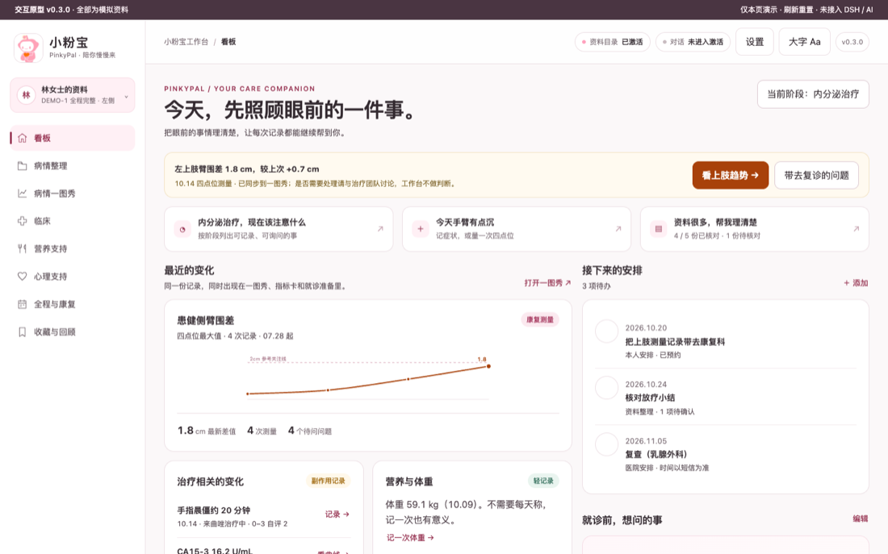

旗舰项目，走得最深：G1–G3 三道闸口已过，v0.12.0。核心能力——**一图秀**（病程一页纵览）、**四点位病灶追踪**（影像测量差值，缺健侧不生成差值）、**指标导入与草稿核对**（含 MinerU 解析）、**就诊准备清单**。缺口：草稿界面收口、四点位录入、导出。👉 [ROADMAP 进度](ROADMAP.md)

### 小铃铛 LymBell · 淋巴瘤 🔵

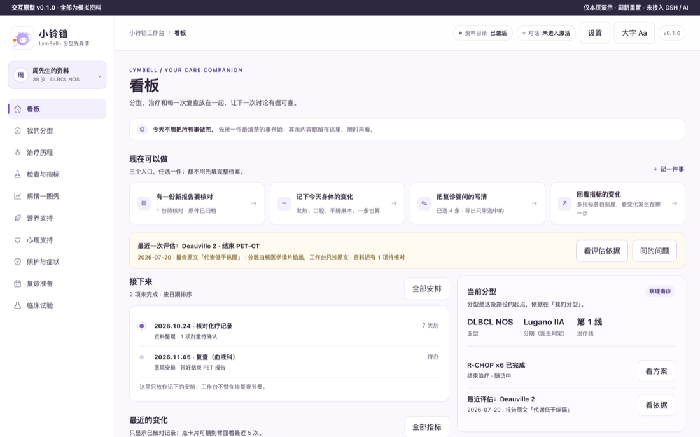

v0.3.0。围绕淋巴瘤多分型、多疗程的特点：分型整理、疗效回顾（每疗程方案与评估）、就诊准备。缺口：分型模块内容补位。👉 [ROADMAP 进度](ROADMAP.md)

### 小肺宝 · 肺癌 🔵

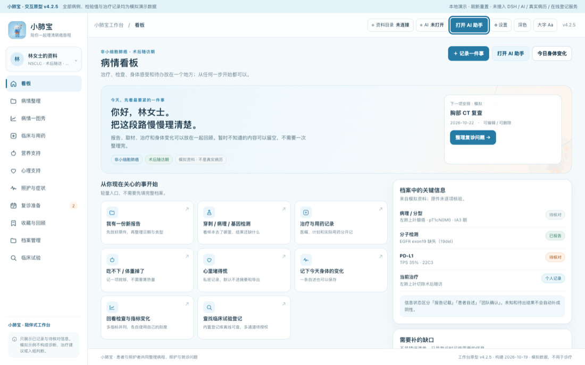

NSCLC 与 SCLC **已合并**在同一个工作台（v0.1.2-rc.15）：病理分型档案（组织学 / 驱动基因）、临床记录断言（每条诊断有来源依据）、临床试验检索（按组织学过滤）。缺口：RC → 正式版、装机验证。👉 [ROADMAP 进度](ROADMAP.md)

### 小巢宝 · 卵巢癌 🔵

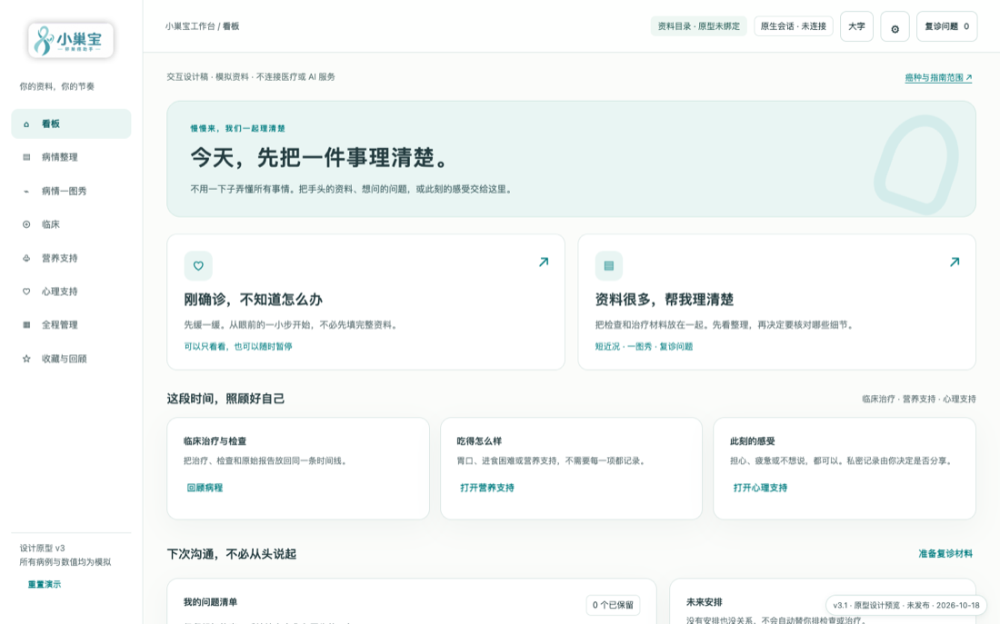

v0.1.51。病程资料、治疗历程（含铂敏感 / 复发线）、指标趋势（CA125 等）、医患沟通准备。缺口：🩺 医学核对与真实场景访谈。👉 [ROADMAP 进度](ROADMAP.md)

### 小畅宝 Colopal · 结直肠癌 🟡

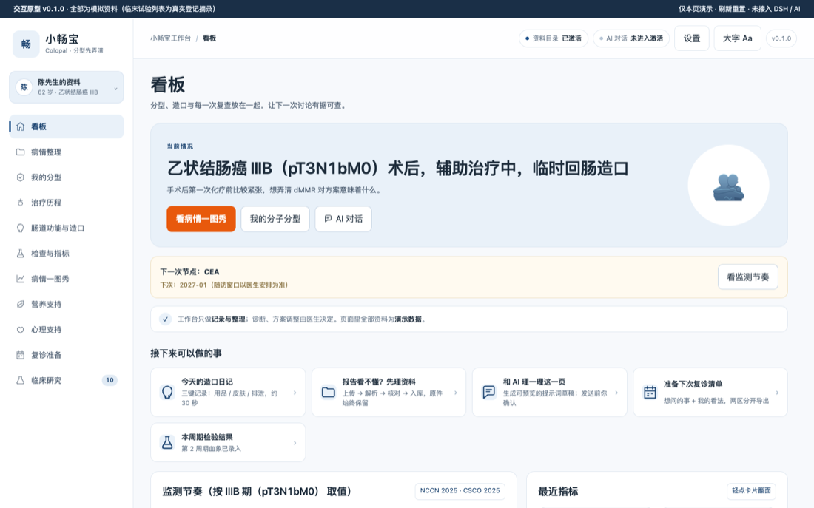

**消化家族样板**（v0.1.0）：分子分型矩阵（MSI / RAS / BRAF）、肠道功能与造口、CEA 序列。它定义的家族基线将被肝 / 胆道 / 小肠 / 壶腹 / 肛门等消化族成员复用。缺口：G3 闸口、装机验证。👉 [ROADMAP 进度](ROADMAP.md)

### 小胃宝 Stompal · 胃癌 🟡

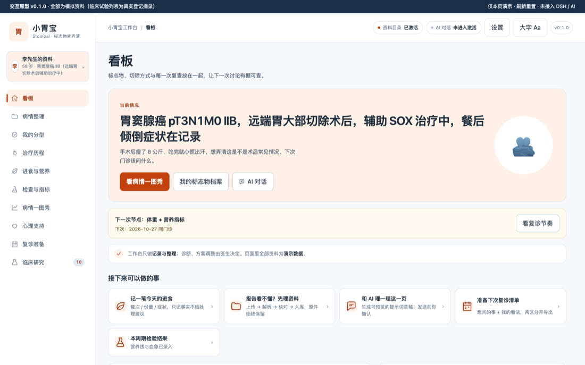

v0.1.0。差异化主打**四标志物**（HER2 / PD-L1 / MSI / CLDN18.2）——它们直接决定治疗路径；进食与营养、体重序列是胃癌患者最日常的两条记录线。👉 [ROADMAP 进度](ROADMAP.md)

### 小咽宝 EsopPal · 食管癌 🟡

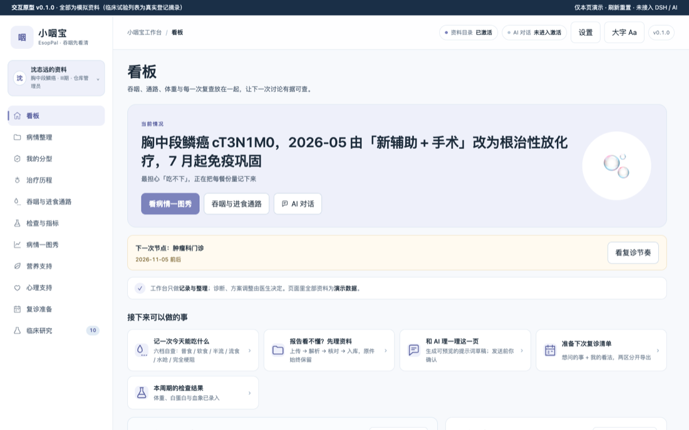

v0.1.0。鳞癌 / 腺癌与分段（颈 / 胸 / 腹）影响方案选择；**吞咽与进食通路** + 体重 / 白蛋白双序列是核心差异化。👉 [ROADMAP 进度](ROADMAP.md)

### 小莲宝 CerviPal · 宫颈癌 🟡

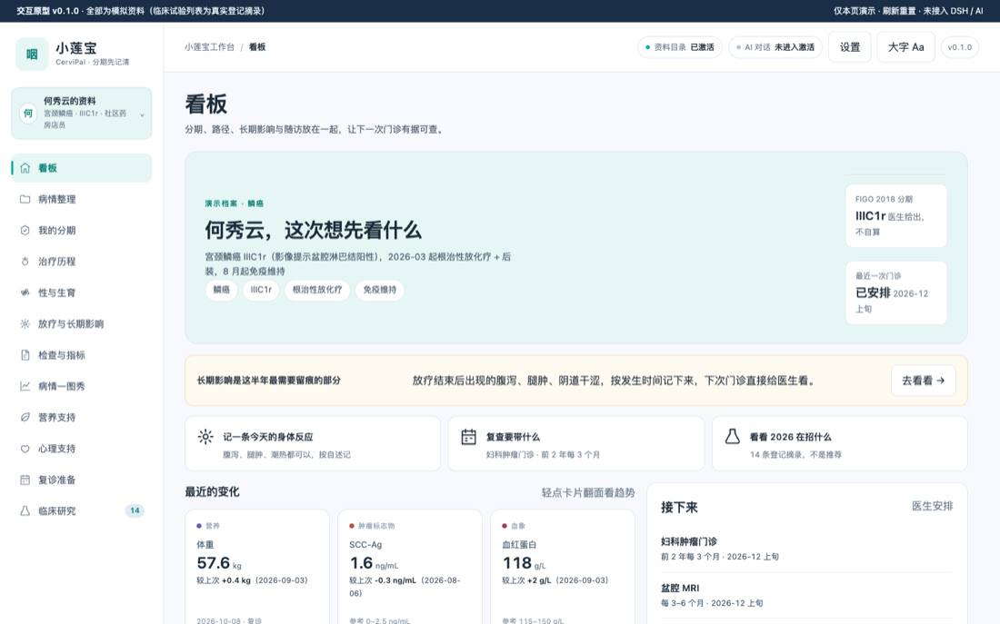

v0.1.1。FIGO 2018 分期档案、性与生育（默认私密板块）、放疗与长期影响记录。👉 [ROADMAP 进度](ROADMAP.md)

### 小萌宝 AnalPal · 肛管癌 🟡

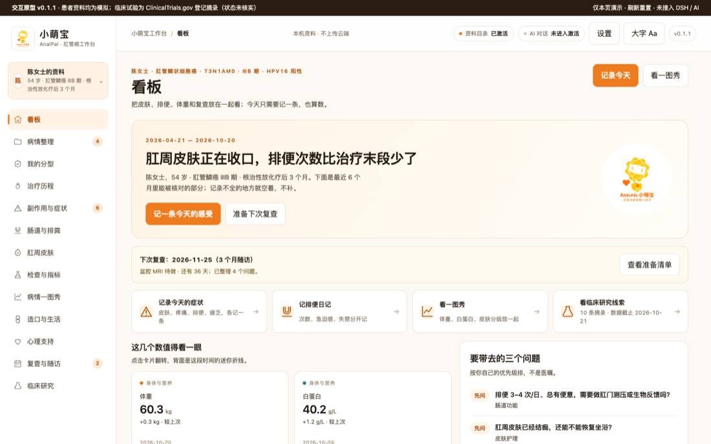

2026-10-21 认领开工（v0.2.0）。差异化：副作用与症状每日一条的轻量记录、**肠道与排粪日记**（次数 / 急迫 / 失禁分记）、肛周皮肤状态（默认私密）、造口与生活。G1/G2/G3 三道闸口均待签。👉 **[认领与协作 Issue #6](https://github.com/xyb-openharness-dsh-plugins/.github/issues/6)**

### 小吉宝 GistPal · 胃肠间质瘤（GIST）🟡

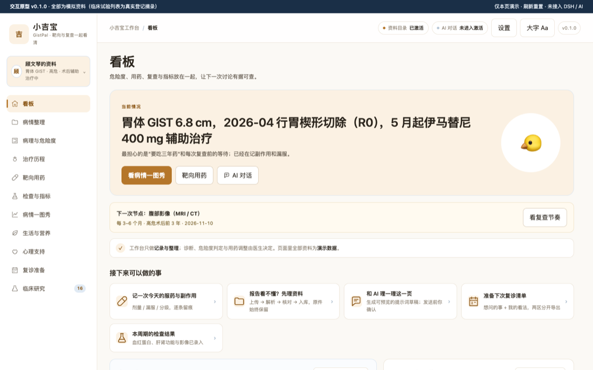

2026-10-21 认领开工（v0.1.0），进度最快的三个新项目之一：25 表 184 列已冻结、原型↔开发版 parity 10/10。差异化：**病理四事实 + 多套危险度体系人话解释**、靶向药线序与剂量变更、复查影像结论结构化。同时是罕见病目录 #32（R1 线唯一独立建仓的例外）。G3 未签认。👉 **[认领与协作 Issue #7](https://github.com/xyb-openharness-dsh-plugins/.github/issues/7)**

### 小胰宝 · 胰腺癌（PDAC）🔵

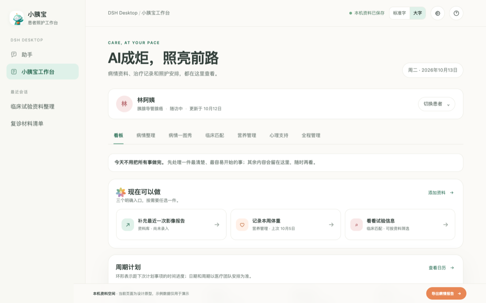

组织的历史旗舰项目（v0.1.34，未走脚手架）：病情资料、临床试验资料整理、营养管理、心理支持、全病程管理一体。待做：既有能力迁移到消化族家族基线，补「不可切除之后」的照护与营养路径。👉 [ROADMAP 进度](ROADMAP.md)

---

## 罕见病工作台

### 小飞侠 · 面肩肱型肌营养不良症（FSHD）🟡

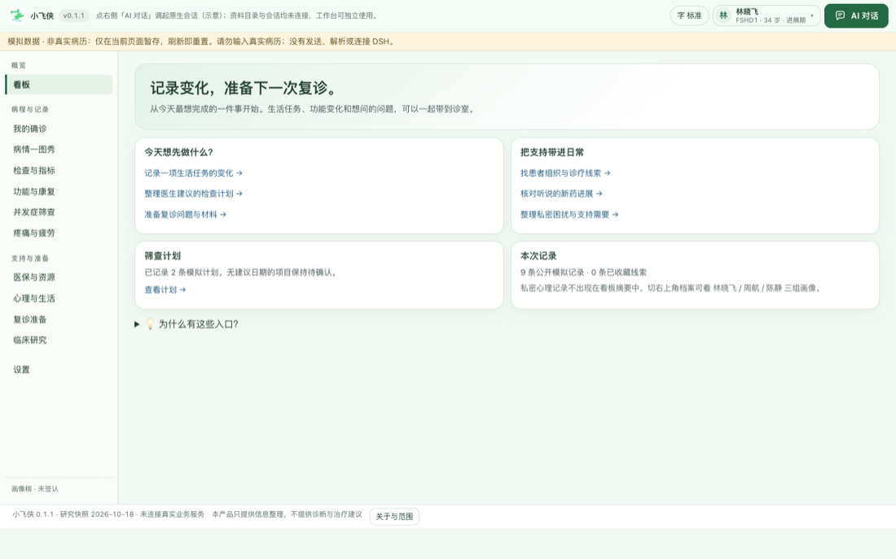

**罕见病形态样板**（v0.1.1）：无获批治疗药物，所以家族内没有「治疗历程」模块，聚焦——确诊档案（基因确诊 D4Z4/4qA）、功能与康复、并发症筛查、医保与资源。这套形态将复制到 30+ 项非肿瘤罕见病。👉 [ROADMAP 进度](ROADMAP.md)

### 小甲宝 ATTR-Pal · 转甲状腺素蛋白淀粉样变性 🟡

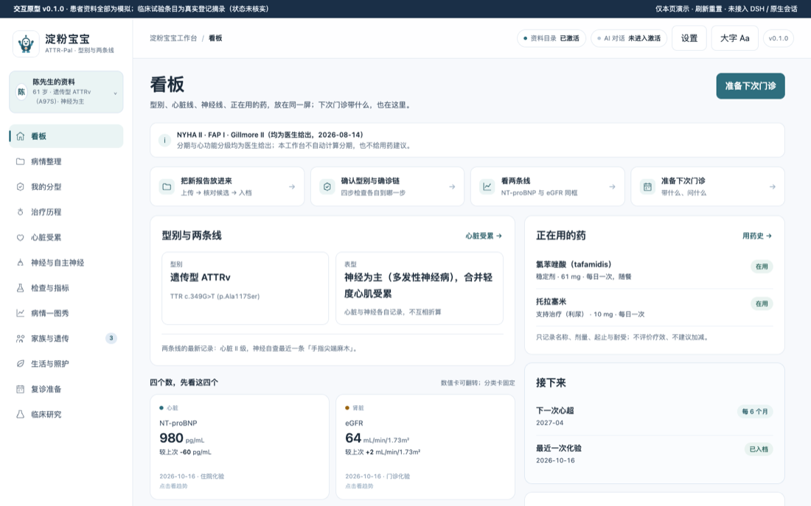

2026-10-21 认领开工（v0.2.0），罕见病 R2 线第二个项目：型别确认档案（遗传型 ATTRv / 野生型 ATTRwt）、**心脏与神经双受累序列**、用药耐受记录（不评价疗效）、家族筛查准备。28 表 schema 与 434 条临床登记摘录已就绪，未装机。👉 **[认领与协作 Issue #5](https://github.com/xyb-openharness-dsh-plugins/.github/issues/5)**

---

## 跨病种支撑

### 小心宝 · 心理支持工作台 🟢

v0.3.14，跨病种的共用支撑模块：为患者与照护者提供情绪陪伴对话、睡眠与情绪记录、资源检索，可被各病种工作台引用。不占病种名额。

---

## 已开工但尚未收录

以下三个仓 2026-10-23/24 才建，原型首页截图与能力说明待补（不先写"已完成"）：`liver-cancer-workbench`（小甘宝 · 肝细胞癌，v0.3.2，G3 已签）、`glioblastoma-workbench`（小星宝 · 胶质母细胞瘤，v0.1.5）、`mesothelioma-workbench`（小胸宝 · 间皮瘤，v0.1.0，G1 已签）。进度见 [ROADMAP](ROADMAP.md) 与 [BACKLOG](BACKLOG.md)。

## 状态图例

| 图标 | 含义 |
| --- | --- |
| 🟢 | 社区可用（V1 检查链 + V2 Desktop 真加载 + V3 真机业务闭环） |
| 🔵 | 开发中（闸口已签，实现中） |
| 🟡 | 设计中（原型 / schema 阶段，闸口待签） |

> 截图与说明的更新频率与各仓版本一致；认领新病种请从 [BACKLOG.md](BACKLOG.md) 的优先招募榜开始。
